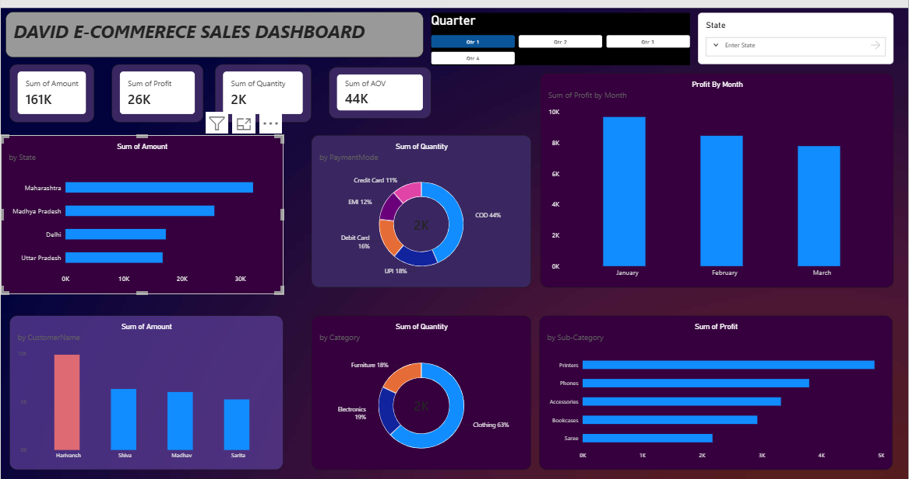

# David E-Commerce Sales Dashboard

An interactive e-commerce sales analytics dashboard built with **Microsoft Power BI**. The dashboard brings key sales and profitability metrics into one place and helps users explore performance across regions, customers, payment methods, product categories, and product subcategories.

## Dashboard Preview




## Project Objectives

- Monitor overall sales, profit, quantity sold, and average order value (AOV).
- Compare sales performance across states.
- Understand the distribution of quantity across payment modes.
- Track monthly profit trends.
- Compare sales amounts across customers.
- Analyze quantity by product category.
- Identify product subcategories with higher reported profit.
- Enable interactive exploration using quarter and state filters.

## Dashboard Features

### 1. KPI Cards

The dashboard displays these headline metrics:

- **Total Sales Amount** — total sales amount in the current filter context.
- **Total Profit** — total reported profit in the current filter context.
- **Total Quantity** — total quantity recorded in the dataset.
- **Average Order Value (AOV)** — intended to represent the average sales value per order.

The screenshot displays approximately **161K sales**, **26K profit**, **2K quantity**, and **44K for the AOV card**. These are the values visible in the current screenshot and may change with filters. Verify the AOV calculation and formatting in the Power BI file before treating 44K as an average per order.

### 2. Sales Amount by State

A horizontal bar chart compares sales amount across states, including Maharashtra, Madhya Pradesh, Delhi, and Uttar Pradesh. In the displayed view, Maharashtra has the highest sales amount among these states.

### 3. Quantity by Payment Mode

A donut chart shows the distribution of quantity by payment mode. The visible labels indicate COD, UPI, debit card, EMI, and credit card. COD has the largest displayed share.

### 4. Profit by Month

A column chart compares profit across January, February, and March. In the displayed view, profit decreases from January to March. The chart shows the trend but does not by itself explain the reason for the change.

### 5. Sales Amount by Customer

A column chart compares sales amounts for the customers shown in the report, including Harivansh, Shiva, Madhav, and Sarita.

### 6. Quantity by Category

A donut chart compares quantity across Clothing, Electronics, and Furniture. Clothing has the largest displayed share.

### 7. Profit by Subcategory

A horizontal bar chart compares reported profit across Printers, Phones, Accessories, Bookcases, and Saree. Printers has the highest displayed profit among these subcategories.

## Tools & Concepts

- **Microsoft Power BI Desktop** — dashboard development and visualization.
- **Power Query** — data cleaning and transformation, if used in the project.
- **DAX** — calculations and measures, if implemented in the project.
- **Slicers and filters** — interactive quarter- and state-based exploration.
- **Data visualization and business analysis** — presenting metrics and trends clearly.

> Only list Power Query transformations, DAX measures, or data-modeling work as completed if they are actually implemented in your `.pbix` file.

## Interactivity

- **Quarter slicer:** select Qtr 1, Qtr 2, Qtr 3, or Qtr 4.
- **State slicer:** filter the report by state.

The report's visual interactions depend on the slicer and visual interaction settings configured in Power BI.

## Suggested Repository Structure

```text
David-E-Commerce-Sales-Dashboard/
├── README.md
├── dashboard-screenshot.png
├── David-E-Commerce-Sales-Dashboard.pbix
└── data/
    └── your-dataset-file.csv
```

Include the `.pbix` file and dataset only if you are permitted to share them. Remove or anonymize any confidential or personal data before publishing.

## How to View the Project

1. Download or clone this repository.
2. Install **Microsoft Power BI Desktop**.
3. Open `David-E-Commerce-Sales-Dashboard.pbix`.
4. If Power BI requests a data source, connect it to the appropriate dataset.
5. Explore the dashboard using the quarter and state slicers.

The exact steps may vary depending on how the source data and file paths are configured.

## Key Insights from the Displayed Dashboard

- Maharashtra leads the displayed states in sales amount.
- COD has the largest displayed share in the payment-mode quantity chart.
- January has the highest displayed profit among January, February, and March.
- Clothing has the largest displayed share of quantity by category.
- Printers has the highest displayed profit among the listed subcategories.

These observations describe the screenshot only. They should be rechecked after applying filters or refreshing the dataset.

## Possible Future Improvements

- Validate and clearly format the AOV measure.
- Add profit margin and order-count KPIs.
- Add year-over-year or month-over-month comparisons if sufficient date data is available.
- Add tooltips and drill-through pages for more detailed analysis.
- Improve accessibility with clear labels, consistent formatting, and sufficient contrast.
- Add data validation checks and document the source dataset.
